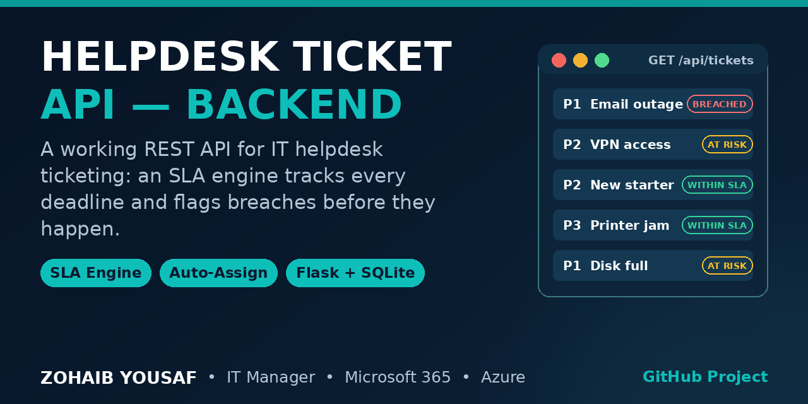

# Helpdesk Ticket API



An SLA-aware IT helpdesk ticketing REST API built with Python, Flask and SQLite. It covers the day-to-day core of an IT support desk: raising and tracking tickets, assigning them to support agents, commenting, and — most importantly — measuring every ticket against priority-based SLA targets for first response and resolution, with live breach and at-risk detection plus compliance statistics.

## Features

- Full ticket CRUD with filtering by status, priority, assignee and category
- SLA engine: response and resolution deadlines are computed per priority at creation, and every ticket reports a live SLA status of `met`, `within_sla`, `at_risk` or `breached`
- Automatic SLA timestamps: the first move out of Open records the response time, and resolving or closing a ticket records the resolution time
- Round-robin auto-assignment across a configurable agent roster when no assignee is given
- Per-ticket comments
- Statistics endpoint: volumes by status and priority, current breaches, at-risk count, SLA resolution compliance percentage and average resolution time
- API-key authentication on all API routes
- Seed script with realistic sample data, plus an automated pytest suite

## Tech stack

- Python 3.12
- Flask 3 (the only runtime dependency)
- SQLite via the Python standard library (`sqlite3`) — no ORM, no external database server
- pytest for the test suite

## Quick start

```bash
cd helpdesk-ticket-api
python3 -m venv .venv
source .venv/bin/activate
pip install -r requirements.txt

python seed.py     # optional: create the database with sample data
python app.py      # serves on http://127.0.0.1:5000
```

If you skip the seed, the app creates an empty database automatically on first run.

### Demo API key

Every `/api` route requires an `X-API-Key` header. For local demo use the key defaults to:

```
demo-key-123
```

Set the `HELPDESK_API_KEY` environment variable to use your own key. Requests with a missing or wrong key receive a `401` JSON response. The `/` route (a short service summary) is public.

## Endpoints

| Method | Path | Description |
| --- | --- | --- |
| GET | `/` | Service summary (public) |
| POST | `/api/tickets` | Create a ticket (auto-assigns if no assignee is given) |
| GET | `/api/tickets` | List tickets; filters: `status`, `priority`, `assignee`, `category` |
| GET | `/api/tickets/<id>` | Get one ticket, including its SLA status |
| PATCH | `/api/tickets/<id>` | Update `status`, `assignee` or `priority` |
| DELETE | `/api/tickets/<id>` | Delete a ticket and its comments |
| POST | `/api/tickets/<id>/comments` | Add a comment (`author`, `body`) |
| GET | `/api/tickets/<id>/comments` | List a ticket's comments |
| GET | `/api/agents` | List agents with skills and open-ticket counts |
| GET | `/api/stats` | Ticket volumes, breaches, at-risk count and SLA compliance |

Ticket fields: `id`, `title`, `description`, `requester`, `category`, `priority` (P1–P4), `status` (Open / In Progress / Resolved / Closed), `assignee`, `created_at`, `updated_at`, `responded_at`, `resolved_at`, `response_due`, `resolve_due`, and a computed `sla` object. An optional `created_at` may be supplied when creating a ticket (useful for data imports and testing).

## Example usage

Create a ticket:

```bash
curl -s -X POST http://127.0.0.1:5000/api/tickets \
  -H "X-API-Key: demo-key-123" -H "Content-Type: application/json" \
  -d '{"title": "VPN not connecting", "requester": "user@example.com",
       "category": "network", "priority": "P2"}'
```

```json
{
  "id": 13,
  "title": "VPN not connecting",
  "requester": "user@example.com",
  "category": "network",
  "priority": "P2",
  "status": "Open",
  "assignee": "Ahmed Raza",
  "created_at": "2026-10-28T14:05:00+00:00",
  "responded_at": null,
  "resolved_at": null,
  "response_due": "2026-10-28T15:05:00+00:00",
  "resolve_due": "2026-10-28T22:05:00+00:00",
  "sla": {"response_status": "within_sla", "resolve_status": "within_sla"}
}
```

List open P1 and P2 tickets:

```bash
curl -s "http://127.0.0.1:5000/api/tickets?status=Open&priority=P1" \
  -H "X-API-Key: demo-key-123"
```

Move a ticket forward (this records the first-response time):

```bash
curl -s -X PATCH http://127.0.0.1:5000/api/tickets/13 \
  -H "X-API-Key: demo-key-123" -H "Content-Type: application/json" \
  -d '{"status": "In Progress"}'
```

Read the statistics:

```bash
curl -s http://127.0.0.1:5000/api/stats -H "X-API-Key: demo-key-123"
```

```json
{
  "total_tickets": 12,
  "by_status": {"Open": 5, "In Progress": 3, "Resolved": 3, "Closed": 1},
  "by_priority": {"P1": 3, "P2": 3, "P3": 3, "P4": 3},
  "breached": {"response": 2, "resolve": 2},
  "at_risk": 2,
  "sla_resolve_compliance_pct": 75.0,
  "avg_resolution_hours": 18.42
}
```

## SLA targets

| Priority | First response | Resolution |
| --- | --- | --- |
| P1 | 15 minutes | 4 hours |
| P2 | 1 hour | 8 hours |
| P3 | 4 hours | 24 hours |
| P4 | 8 hours | 48 hours |

Targets are defined in `config.py` and can be changed in one place.

## How the SLA engine works

When a ticket is created, its priority's targets are applied to the creation time and stored as `response_due` and `resolve_due` deadlines. On every read, each deadline is classified against the current time and the recorded action timestamps (`sla.py`):

- `met` — the response or resolution happened on or before its deadline
- `within_sla` — still pending, with comfortable time left
- `at_risk` — still pending, with less than 25% of the SLA window remaining
- `breached` — the deadline passed without the action, or the action happened late

The first time a ticket leaves the Open status, `responded_at` is recorded; moving it to Resolved or Closed records `resolved_at`. Changing a ticket's priority recomputes both deadlines from the original creation time. The `/api/stats` endpoint aggregates the same classifications across all tickets and calculates resolution compliance as the share of resolved tickets that were resolved by their `resolve_due` deadline.

## Sample data

`python seed.py` resets the database and loads **sample data**: 12 sample tickets across all priorities and statuses (including tickets already resolved within SLA, one breached, and at-risk cases, created with backdated timestamps so the SLA states are genuine), plus sample comments. The four agents in `config.py` are sample agents for the demo roster. None of this is real operational data.

## Running tests

```bash
pip install pytest
python -m pytest -q
```

The suite uses the Flask test client against a throwaway database and covers ticket creation and SLA deadline maths, filtering, status transitions and their timestamps, breached and at-risk computation, round-robin assignment, comments, authentication, and the statistics calculations.

## Project structure

```
helpdesk-ticket-api/
├── app.py            # Flask application: routes, auth, database access
├── config.py         # SLA targets, priorities, statuses, agent roster
├── sla.py            # SLA deadline computation and status classification
├── seed.py           # Loads the sample data set
├── requirements.txt  # flask>=3
├── tests/
│   ├── conftest.py   # Test fixtures and helpers
│   └── test_api.py   # End-to-end API tests
├── LICENSE
└── README.md
```

## Author

Zohaib Yousaf — IT Manager & Web Developer
